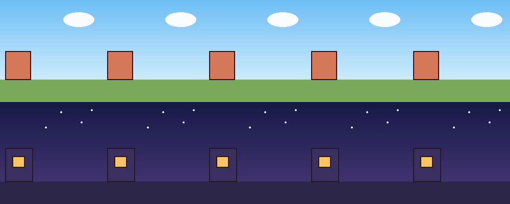
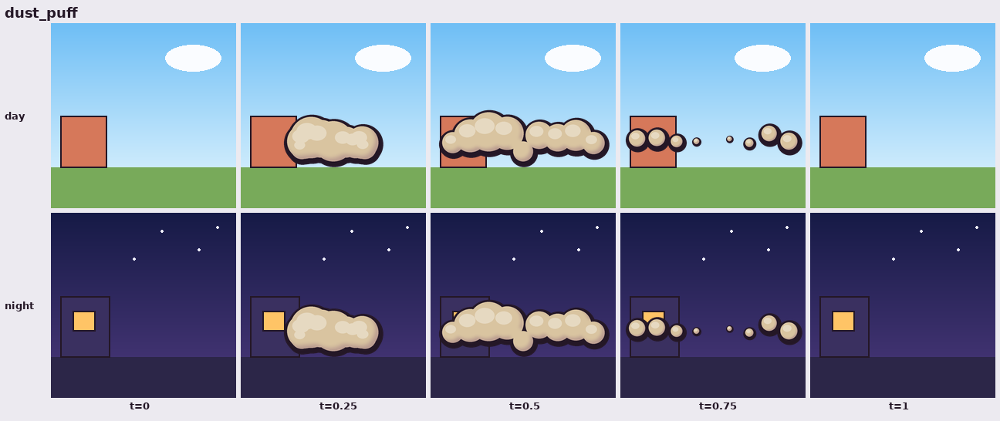
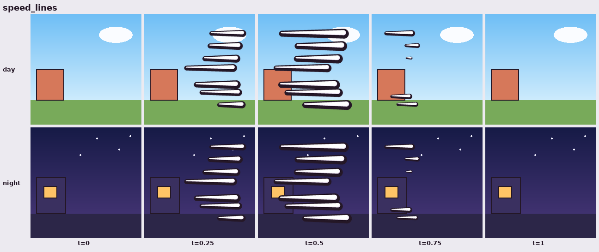
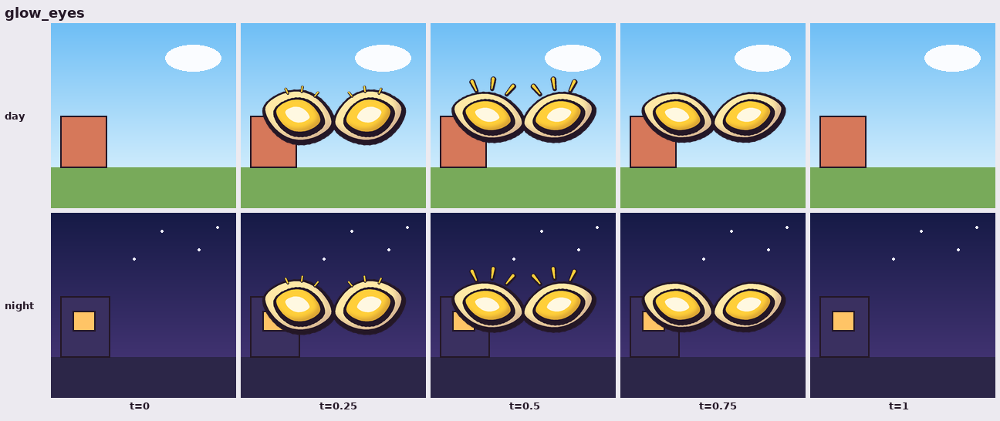
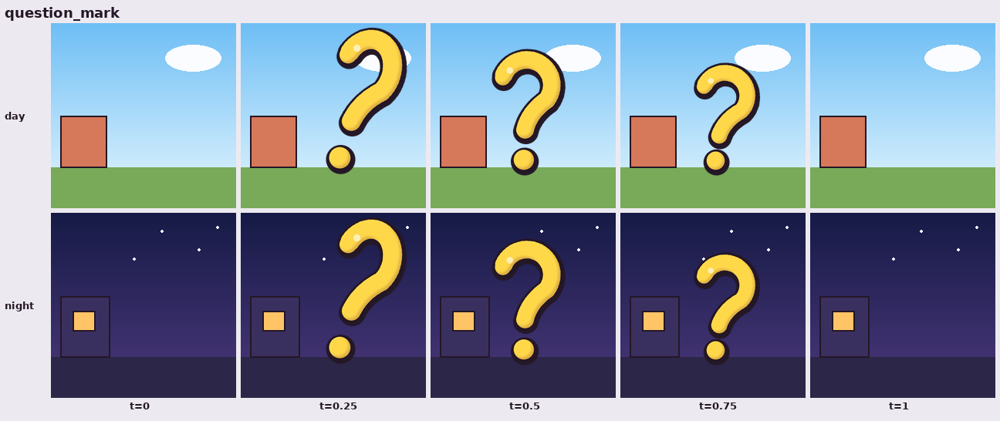
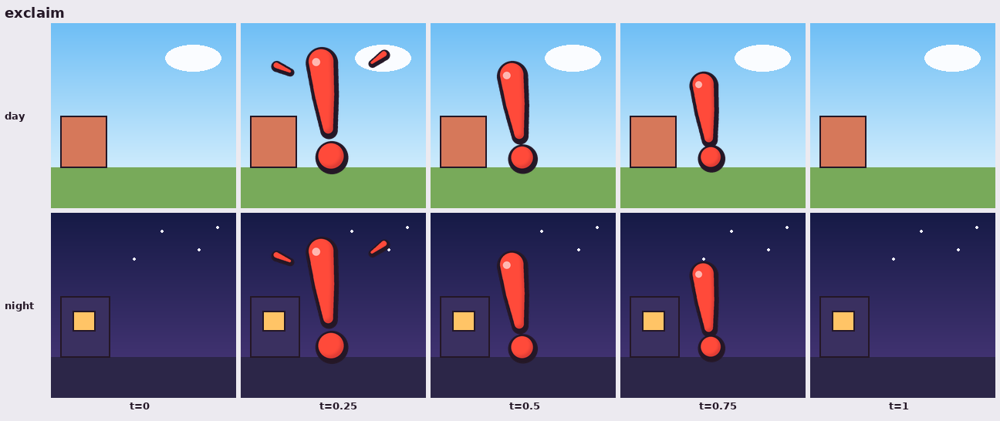
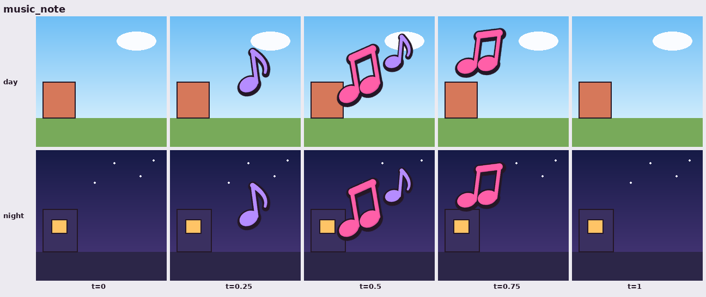

# FX catalog

`fx/fx.py` draws every effect procedurally (4x supersampled, flat saturated colour, soft crescent shading, plum ink `#241726` that is thin on the top-left and about 3x thicker on the bottom-right), in the bean-head cast style (`characters/scripts/bean.py`, spec `references/reports/characters.md` §2).

```python
import sys; sys.path.insert(0, 'fx'); import fx
img = fx.render('explosion', t=0.3, size=400, color='#ff8a1f')   # RGBA 400x400, t = 0..1 over the effect's life
```

- **The canvas is square.** The effect is centred and fills about 90% of it. Use `scale=` to shrink the content inside the canvas.
- **Every effect is empty at t=0 and at t=1.** Each one has anticipation, then a peak with overshoot, then a shrink-out. Map any duration onto t, for example 0.5-1.2 s (15-36 frames) at 30 fps.
- **Common kwargs:**
  - `color`: hex or RGB.
  - `scale`: default 1.
  - `line`: the mean ink width in output px. The thin side is 0.5x and the thick side 1.5x. The default is 5. To match the cast's props, pass `line=10*k` when the engine scales the 600x1000 character card by `k`.
  - `seed`: varies the layout.
- **Anchors:**
  - `dust_puff` and `splash` sit their base on a ground line at about 0.72 of the canvas height.
  - `music_note` rises from the bottom centre.
  - Every other effect is centred.
- **Previews:** run `.venv/bin/python fx/scripts/catalog.py` to rebuild the strips and the GIF. It also runs the automatic checks (empty at both ends, no coverage jump > 35% of peak between 1/60 steps) and exits non-zero on failure.
- **Strips:** each one shows t = 0, .25, .5, .75, 1, over a day tile (top) and a night tile (bottom).



### `explosion`
puffy fire cloud + white flash core + sparks, cools to smoke and rises. Kwargs: color, core, smoke.


### `impact_star`
spiky hit star + impact ticks. Kwargs: color, inner, points, angle.


### `dust_puff`
ground puffs rolling out sideways. Kwargs: color, direction=both|left|right.



### `speed_lines`
streaks behind a moving thing. Kwargs: color, count, angle (travel direction, deg).



### `sweat_drop`
drop forms, wobbles, slides down. Kwargs: color, flip.


### `anger_vein`
four-arc anger mark that throbs twice. Kwargs: color.


### `glow_eyes`
two glowing eye discs with a halo. Kwargs: color, gap, radius.



### `sparkle`
staggered twinkling 4-point stars. Kwargs: color, count.


### `splash`
water crown + ballistic drops + ring. Kwargs: color.


### `question_mark`
popping, wobbling ?. Kwargs: color, tilt.



### `exclaim`
popping, shaking ! with surprise ticks. Kwargs: color, tilt.



### `music_note`
notes rising and swaying. Kwargs: colors, count.


