# FX catalog

`fx/fx.py` draws every effect procedurally (4x supersampled, flat saturated colour, soft crescent shading, plum ink `#241726` that is thin on the top-left and about 3x thicker on the bottom-right), in the bean-head cast style (`characters/scripts/bean.py`, spec `references/reports/characters.md` §2).

```python
import sys; sys.path.insert(0, 'fx'); import fx
img = fx.render('explosion', t=0.3, size=400, color='#ff8a1f')   # RGBA 400x400, t = 0..1 over the effect's life
```

- **The canvas is square.** The effect is centred and fills about 90% of it. Use `scale=` to shrink the content inside the canvas.
- **Every effect is empty at t=0 and at t=1.** Each one has anticipation, then a peak with overshoot, then a shrink-out. Map any duration onto t, for example 0.5-1.2 s (15-36 frames) at 30 fps.
- **Common kwargs:**
  - `color`: hex or RGB.
  - `scale`: default 1.
  - `line`: the mean ink width in output px. The thin side is 0.5x and the thick side 1.5x. The default is 5. To match the cast's props, pass `line=10*k` when the engine scales the 600x1000 character card by `k`.
  - `seed`: varies the layout.
- **Anchors:**
  - `dust_puff` and `splash` sit their base on a ground line at about 0.72 of the canvas height.
  - `music_note` rises from the bottom centre.
  - Every other effect is centred.
- **Previews:** run `.venv/bin/python fx/scripts/catalog.py` to rebuild the strips and the GIF. It also runs the automatic checks (empty at both ends, no coverage jump > 35% of peak between 1/60 steps) and exits non-zero on failure.
- **Strips:** each one shows t = 0, .25, .5, .75, 1, over a day tile (top) and a night tile (bottom).


### `explosion`
puffy fire cloud + white flash core + sparks, cools to smoke and rises. Kwargs: color, core, smoke.

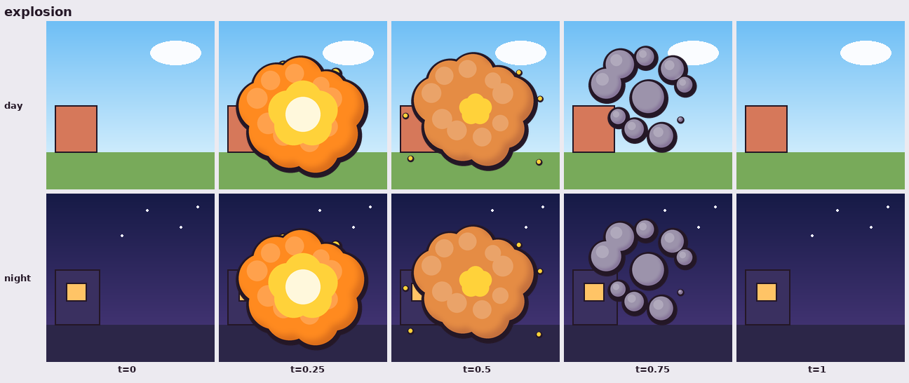

### `impact_star`
spiky hit star + impact ticks. Kwargs: color, inner, points, angle.

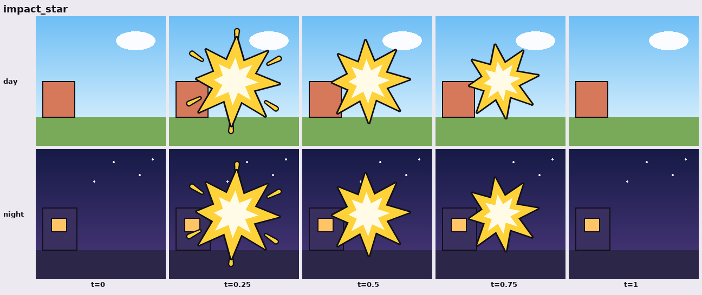

### `dust_puff`
ground puffs rolling out sideways. Kwargs: color, direction=both|left|right.


### `speed_lines`
streaks behind a moving thing. Kwargs: color, count, angle (travel direction, deg).


### `sweat_drop`
drop forms, wobbles, slides down. Kwargs: color, flip.

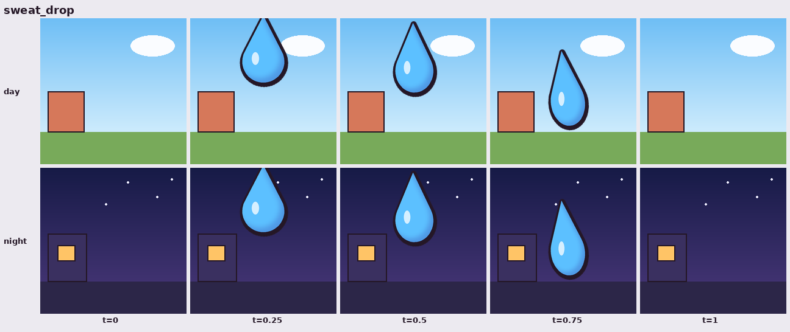

### `anger_vein`
four-arc anger mark that throbs twice. Kwargs: color.

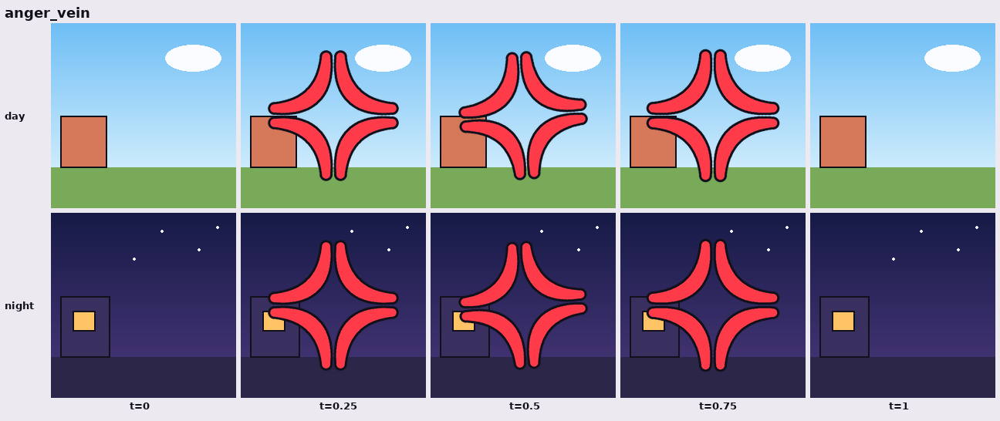

### `glow_eyes`
two glowing eye discs with a halo. Kwargs: color, gap, radius.


### `sparkle`
staggered twinkling 4-point stars. Kwargs: color, count.

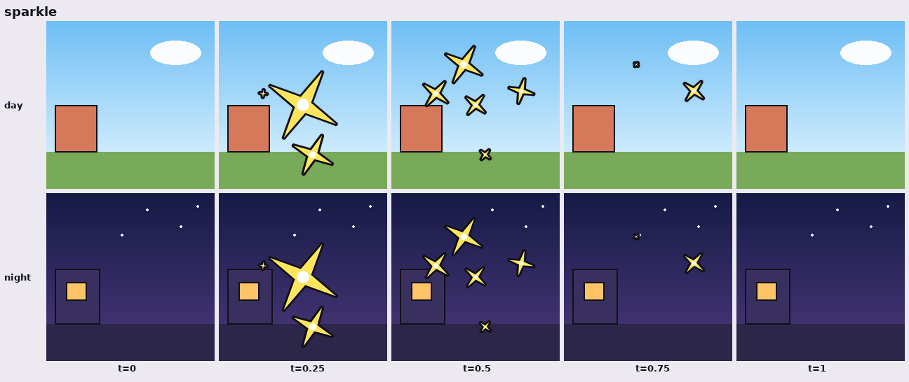

### `splash`
water crown + ballistic drops + ring. Kwargs: color.

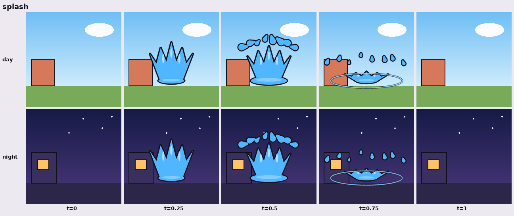

### `question_mark`
popping, wobbling ?. Kwargs: color, tilt.


### `exclaim`
popping, shaking ! with surprise ticks. Kwargs: color, tilt.


### `music_note`
notes rising and swaying. Kwargs: colors, count.


## Diagram effects (first video: `bike-countersteer`)

### `steer_arrow`
curved arrow showing a turn direction, or a red stop bar. Kwargs: direction=left|right|blocked, color, sweep (deg).

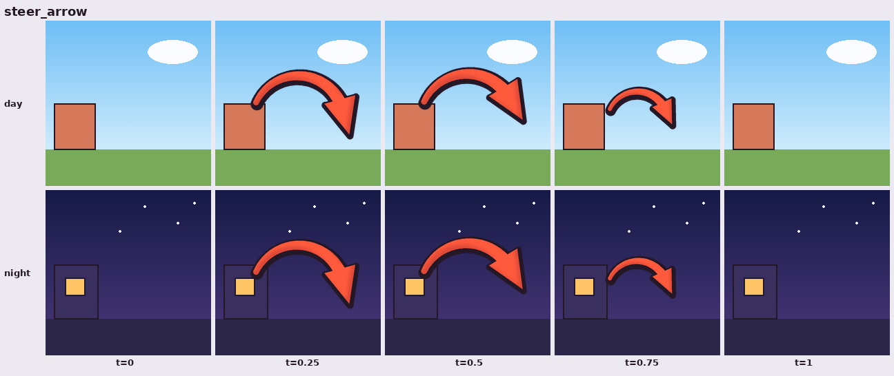

`direction='blocked'`:

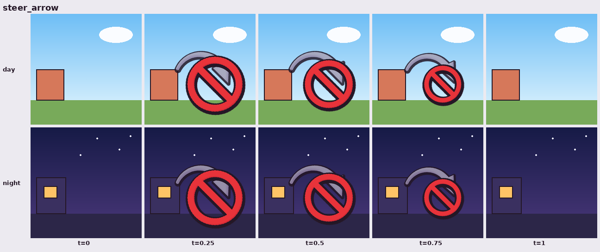

### `path_line`
top-down track: dashed planned path + actual path drawn on with a rider dot. Kwargs: planned, actual (tight_left|wide_arc|kink_right_then_left or points), color, planned_color.

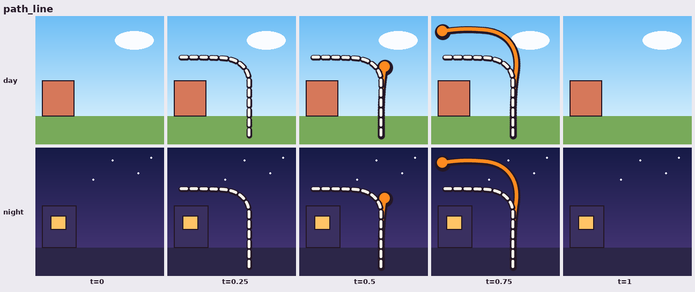

`actual='kink_right_then_left'`:

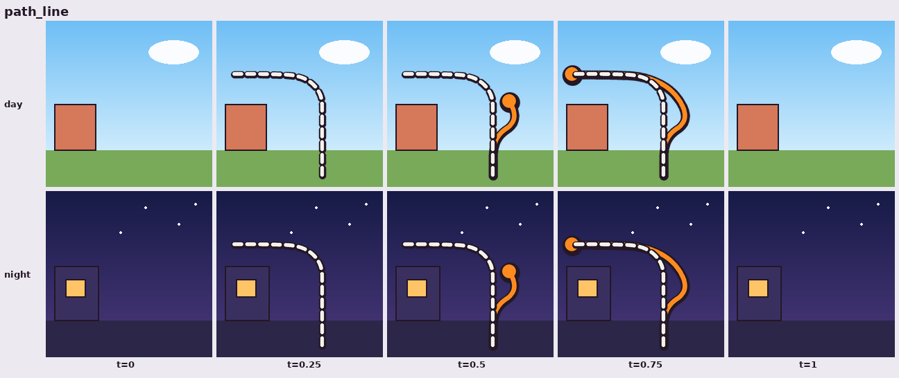

### `lean_arc`
lean-angle diagram: vertical ref, leaning line, arc + tick; pivot at bottom centre. Kwargs: angle (deg), side=left|right, color, ref.

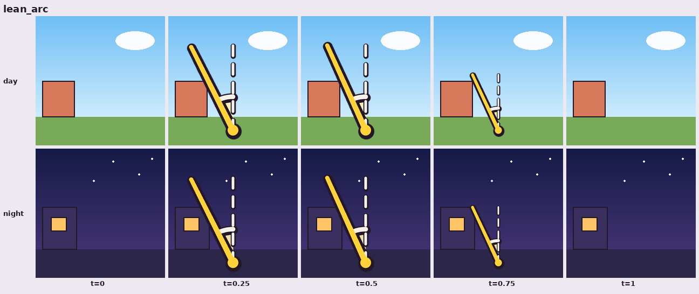

### `wobble_lines`
wobbling motion arcs beside a wheel at the centre. Kwargs: color, sides=both|left|right.

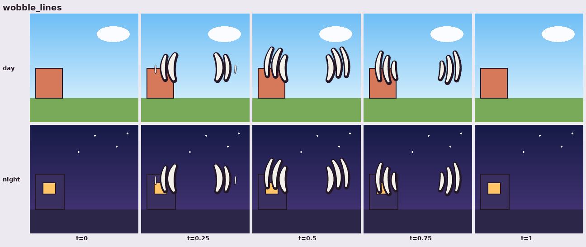

### `whoosh`
tapered speed swoosh with two trailers. Kwargs: color, angle (travel direction, deg).

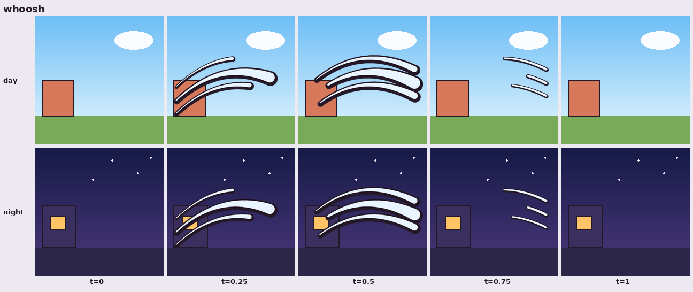

## Video 2 (`sailing-stones`): playa, ice and weather

Environment effects (`ice_pane`, `dust_storm`, `flash_flood`, `rain`) enter by spreading or rolling in and leave by receding, with only the last ~8% as an alpha fade. They are still empty at t=0 and t=1. `dust_storm`, `flash_flood` and `rain` are meant to be placed full-frame (`size` = the frame width, centred).

### `ice_pane`
The mechanism, one stage per call. Kwargs:
- `stage`: one of
  - `water`: a shallow pond spreads, with ripples and sky glints;
  - `freeze`: thin ice grows in from the rim, with frost needles and a sparkle;
  - `panes`: white cracks race along the sheet from the centre, then it splits into panes over dark water;
  - `drift`: the panes slide downwind, with gaps of dark water opening behind them.
- `view`: `top` (straight down, a round pond) or `side` (low angle: a phone-thin sheet seen edge-on near the bottom).
- `direction`: `left`, `right`, `up` or `down`.
- `seed`.

Chain the stages in one framing by calling them in order: water, then freeze, then panes, then drift.

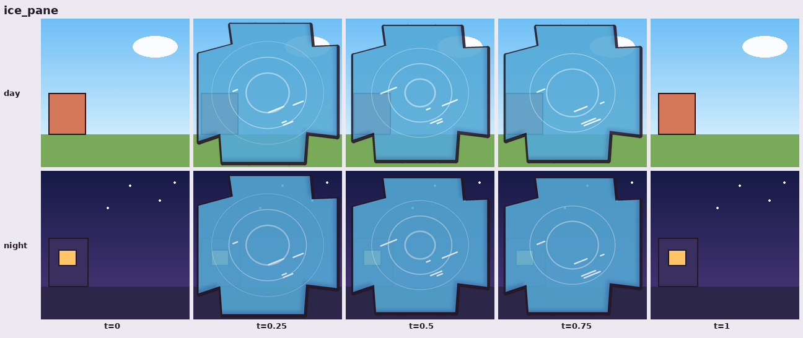
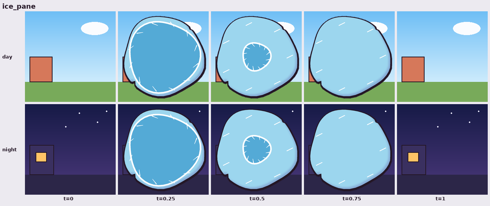
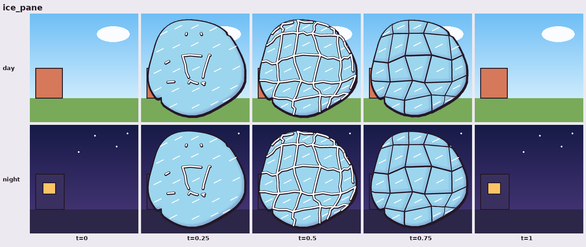
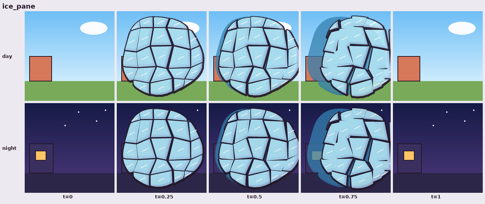
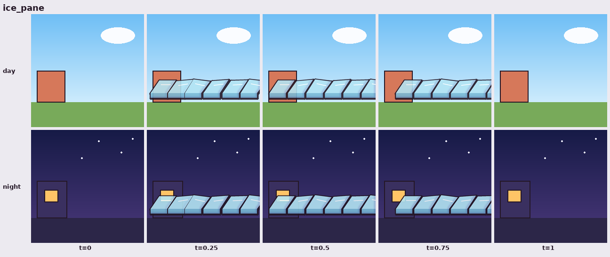

### `ice_crack`
White crack lines race out from the centre and branch, then erase from the centre outward. Kwargs: color, seed.

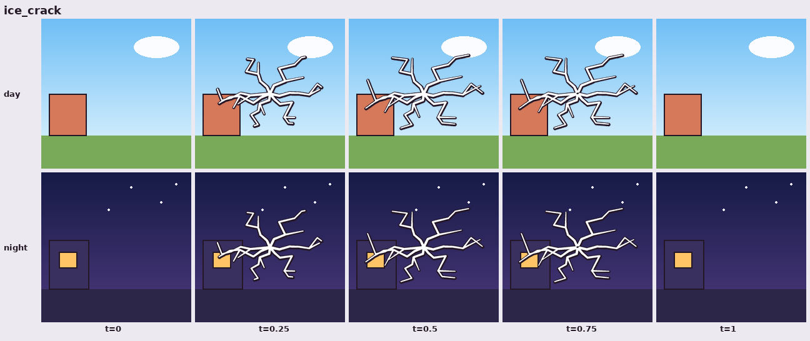

### `sliding_rock`
Rocks creak back, glide (ease in-out) and stop, each carving a groove trail (darker clay with a light rim). Kwargs:
- `path`: either `'away'` (from the bottom toward the horizon at the canvas middle, shrinking) or `[[x, y], ...]` in **canvas** fractions (0..1). The engine converts frame fractions to canvas fractions.
- `count`: the number of rocks, spread across.
- `sprite`: `rock` or `fridge`.
- `trail`: default True.
- `seed`.

The trail exists only while the effect lives. For a trail that stays, the set or engine draws `rock_trail_hero` on the plate.

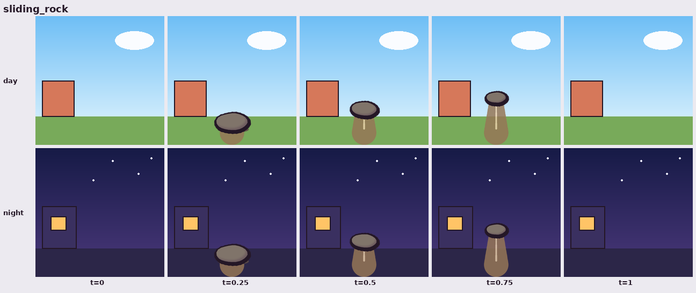
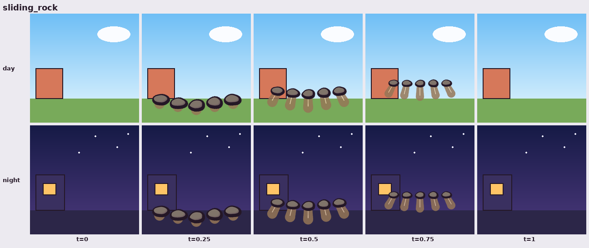
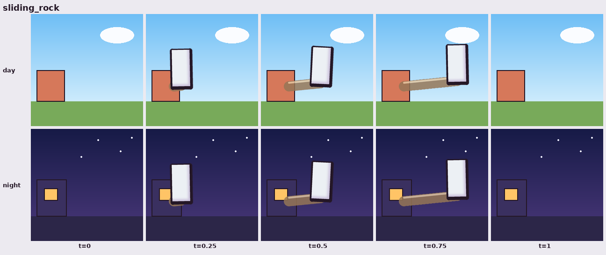

### `gps_ping`
A green tracker dot pops in and pulses, while radar rings expand from it (3 rings, twice). Kwargs: color.

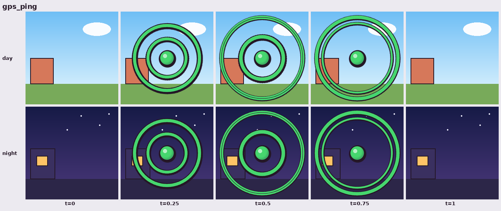

### `year_badge`
A UI tag for the top third: white Poppins Bold on a plum pill. It pops in with a squash, bobs gently, then shrinks out. Kwargs: `label` (e.g. `'1948'`, `'MONTH 1'`, `'YEAR 2 · LAST TRY'`; long labels shrink to fit), color.

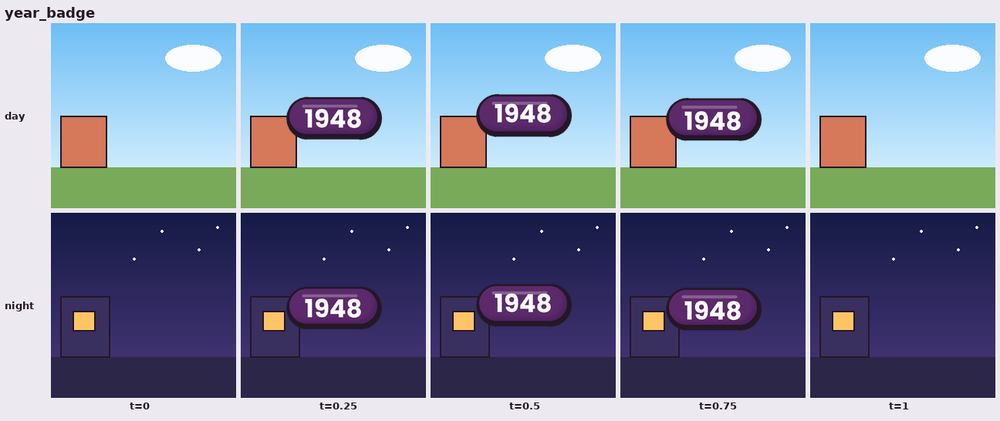
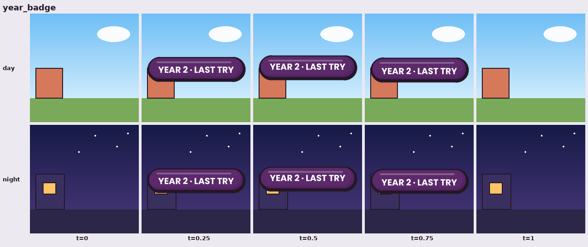

### `dust_storm`
A brown wall of dust rolls across, churning with grit streaks. It buries the frame, then settles to the ground and clears. Kwargs: direction=right|left, color, seed.

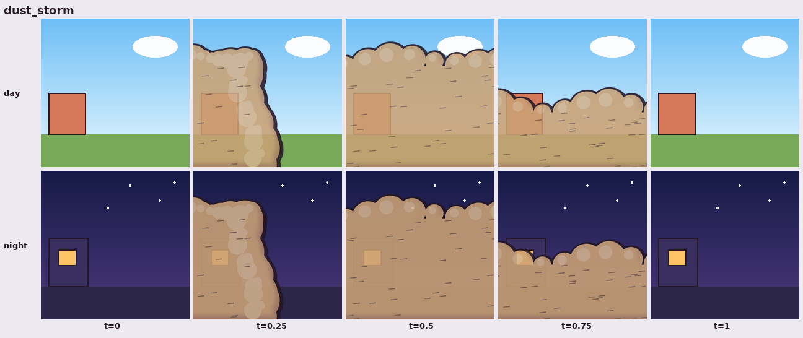

### `flash_flood`
A muddy wall of water rushes in with a foaming crest, floods the bottom ~40% of the frame with choppy water, then recedes. The ground is the canvas bottom. Kwargs: direction=right|left, color.

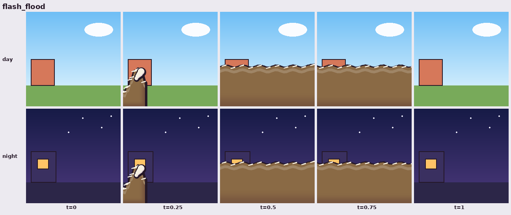

### `rain`
Slanted rain streaks fall with splash ticks at the bottom. The rain builds up, pours, then eases off. Kwargs: angle (deg from vertical, default 15), density, color, seed.

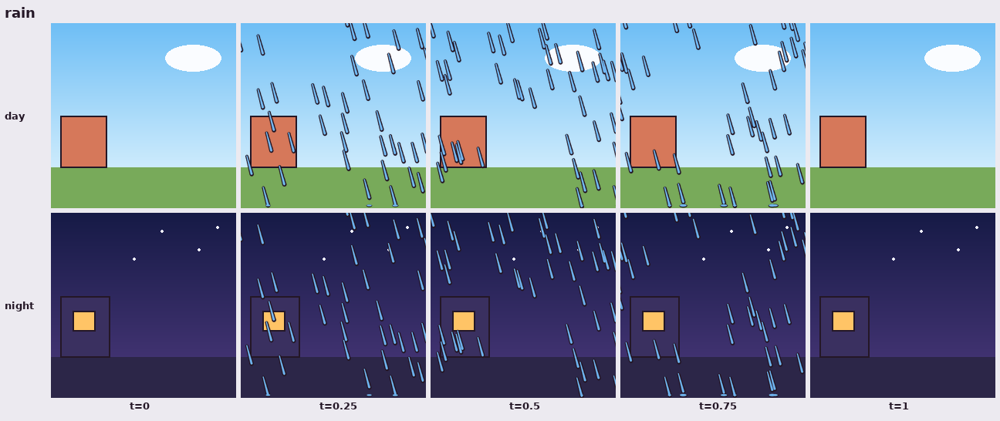

These effects next to bean characters:

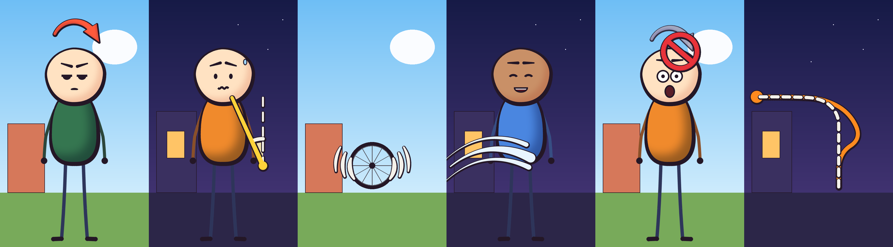
